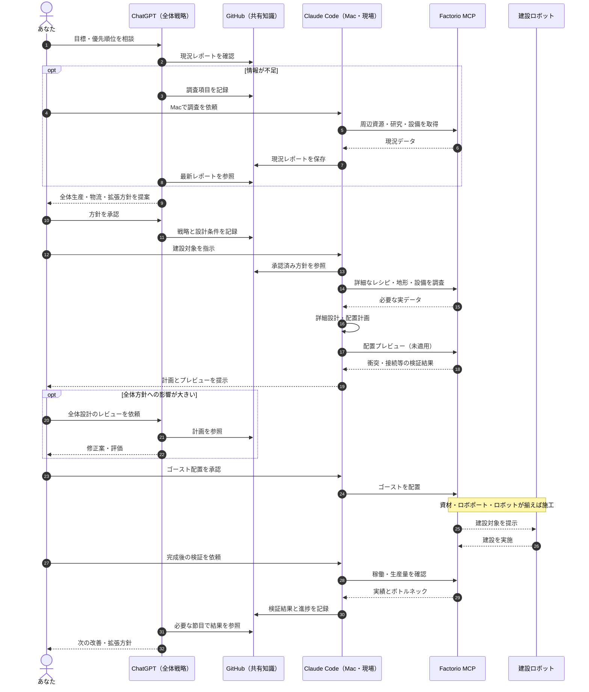

# Factorio AI Engineer

## このゲームで目指すもの

最初の鉄板は、自分で鉱石を掘り、炉に火を入れて作る。いつかその炉を置いた場所を、鉱石を満載した長い貨物列車が通り過ぎる。線路をどこに引くか迷ったことも、川を避けて工場が妙な形になったことも、上空から見下ろせば、自分たちがこの星で過ごした時間として地図に残っている。

目指すのは、そんな地図を、いつか別の星にまで広げることだ。遠い惑星で初めての工場を建てているあいだにも、故郷ではあの列車が走っている。そこで作った部品が宇宙を渡って届いたら、今度はその部品で、この星に最初の線路を敷こう。

## 概要
Claude CodeからFactorio LLM Use MCP（RCON経由）を使い、AngelBob + Space Ageの工場を調査・設計・建設するプロジェクトです。
建設は計画（plans/）の作成、プレビュー、承認を経て、ゴーストとして配置します。
レシピはゲーム内の値のみを使い、撤去などの変更は承認を必須とします。
ルールの詳細は `CLAUDE.md` を参照してください。

## 役割分担

| 担当 | 役割 |
| --- | --- |
| あなた | 目標設定・方針決定・建設承認 |
| ChatGPT | 全体戦略：生産計画、地区配置、鉄道網、長期的な拡張方針 |
| GitHub | 現況レポート・戦略・設計・進捗の共有 |
| Claude Code（Mac） | 現場責任者：ゲーム調査、詳細設計、プレビュー、承認後のゴースト配置・検証 |
| Factorio / 建設ロボット | ゴーストに基づく施工（資材・建設範囲が必要） |

ChatGPTとClaude Codeは常時直接通信せず、GitHubの文書を通じて情報を引き継ぎます。Claude Codeは必要なときだけMacで手動起動し、ローカルのFactorio MCPに接続します。ゲーム開始直後は手動建設を優先し、ロボット解放後にゴースト施工へ移行します。

## 共同開発シーケンス

### 運用原則

- 全体方針はChatGPT、現場の事実確認と詳細設計はClaude Codeが担当する。
- 調査は必要な範囲に限定し、トークンを節約する。
- ゴースト配置・撤去などのゲーム変更は `CLAUDE.md` に従い承認を得る。
- GitHub ActionsのClaudeはコード・ドキュメント作業用。Macのゲームサーバーを直接操作しない。
