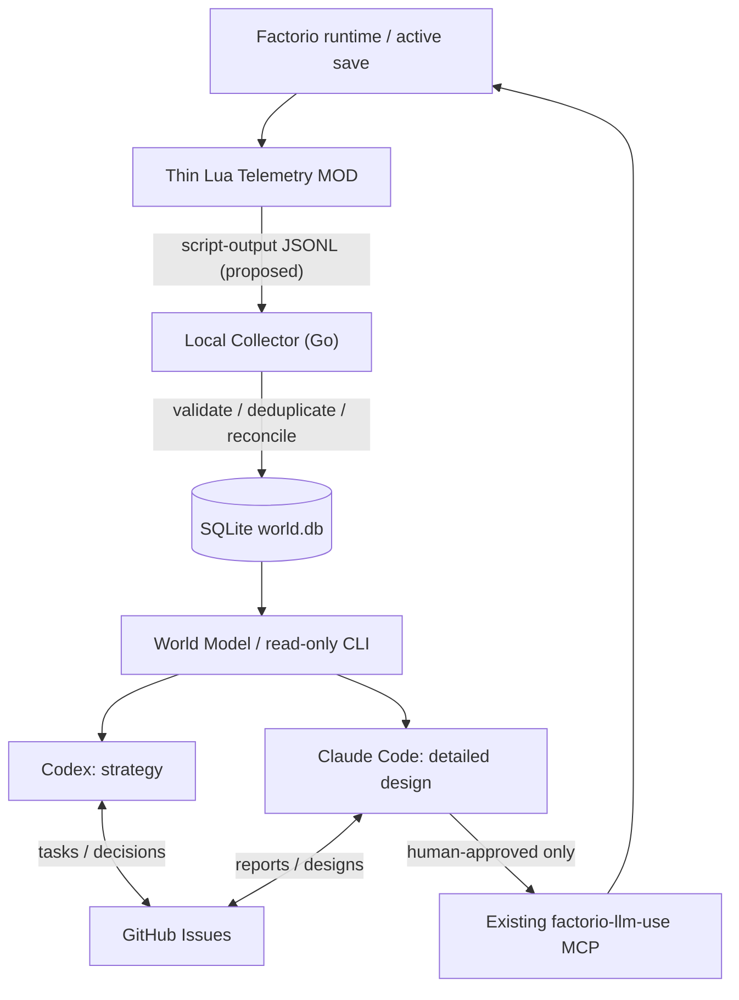

# World Model Architecture — Phase 0

Status: **proposed, unimplemented**. Parent: [Issue #17](https://github.com/dkpcb/factorio/issues/17). Scope: Phase 0 (design only).

## Decision

Separate (1) observation, (2) world-state storage/inference, and (3) gameplay mutation. The first vertical slice is a **research-state change from Factorio -> Telemetry MOD -> file -> Collector -> SQLite -> read-only query**. No paid AI API.

## Existing integration (verified in repository, not source audited)

- `docs/setup.md`: `factorio-llm-use/scripts/start_server.py --resume` launches a local Factorio server with a **copy** of the save under `~/factorio-llm-use/.runtime/data/saves/`; `save_session.py` persists the session; multiplayer connection is `127.0.0.1:34199`.
- `CLAUDE.md`: MCP operates through RCON, `get_world`, `observe`, `list_recipes`, `inspect_entity`, `create_plan`, `preview_plan`, `apply_plan(mode="ghosts")` are used; `execute_lua` is constrained.
- `docs/mods.md`: AngelBob + Space Age and `factorio_llm_use` enabled.
- **Not verified:** the actual source of the locally installed `factorio-llm-use`, server process topology and the authoritative save instance, mod installation path, capabilities/limits of API and RCON, and whether a mod can be installed/updated without breaking the current session. Audit on the Mac before Phase 1.

**Key implication:** distinguish the main Factorio save from the AI-controlled server's copied save. The Collector must observe the same runtime that the agents operate on, not infer identity from the filename or `localhost` alone.

## Boundary contracts

| Component | Owns | Does not own |
| --- | --- | --- |
| Factorio | Authoritative running world, research, entities | External AI plans |
| Telemetry MOD | Read game state, emit events/snapshots; minimal persistent cursors | SQLite, HTTP API, AI inference, game mutation |
| Collector | Parse / validate / checkpoint / reconcile, recover incomplete streams | Change game state |
| SQLite | External projection + observations + derivations | Authoritative gameplay state |
| World Model | Normalized state, topology, known/unknown, simulation inputs | Write back to Factorio |
| Codex | Strategy and priorities using read-only queries | Execute game changes |
| Claude Code | Local detail design, approved construction via existing MCP | Unapproved construction |
| GitHub | Issues, specs, PRs, decision history | Live world snapshot authority |

## Observation semantics

- Every record has `schema_version`, `run_id`, `world_id`, `surface_index` where applicable, `tick`, `sequence`, `event_type`, `payload`. `world_id` and `run_id` issuance, save-copy lineage, and resume behavior must be prototyped, not assumed.
- `sequence` is monotonically increasing within a **run/stream**, not globally across a save rollback. Events are idempotently inserted by `(run_id, sequence)`.
- Equipment identity: `unit_number` when available, plus surface and a fallback compound identifier for entities without it. Never assume position is an immutable primary key.
- Snapshot has declared `scope` and `complete` markers. **Unobserved != absent**. Scoped snapshots can replace only records within their verified scope.
- Observed / inferred / unknown are distinct. Track `observed_tick` and source; reject stale planning if the active save or observation recency no longer matches.
- Keep event history for debugging, but allow bounded retention and summarized production metrics. Avoid per-tick full-map dumps.
- A world rollback may rewind the game's stored MOD state even though exported files remain on disk. Until a robust save lineage protocol is proven, **force fresh reconciliation on every load/resume and consider the previous run stale**.

## Factorio 2.x API facts checked

- Runtime is event-driven, including `on_research_finished`, `on_built_entity`, and mining/robot/script-related events; coverage must include all relevant build/remove pathways: https://lua-api.factorio.com/latest/events.html
- `helpers.write_file(filename, data, append?, for_player?)` writes inside the game's `script-output`, supports append and server output via `for_player=0`: https://lua-api.factorio.com/latest/classes/LuaHelpers.html
- `storage` persists with a save, but it **cannot be written within `on_load`**; init/config-change handlers have different access constraints: https://lua-api.factorio.com/latest/auxiliary/storage.html and https://lua-api.factorio.com/latest/classes/LuaBootstrap.html
- `LuaEntity.unit_number` is only present for eligible entities, and is unique for the lifetime of the save: https://lua-api.factorio.com/latest/classes/LuaEntity.html
- `helpers.send_udp` exists in current docs but requires an opt-in server flag; **not selected for MVP**: https://lua-api.factorio.com/latest/classes/LuaHelpers.html

Docs viewed are current 2.1.x online; **pin and verify against the running 2.1.24 game** before shipping.

## Transport decision for initial prototype

**Selected candidate:** append JSONL in `script-output/factory-telemetry/` -> local polling Collector -> SQLite.

Reasons: no paid service, minimal coupling, local integration, easily inspectable. Risks: partial lines, replayed files, missing events, file growth, load rollback, multiplayer host versus client `script-output`. All are Phase 1/2 test cases. Writing one file is *not* a durable queue or guaranteed exactly-once delivery.

**Alternative after measurement:** localhost UDP. Requires explicit engine configuration and delivery/recovery design; not justified for first slice.

## Game safety and performance

- Develop on a dedicated **copy** of the save. Preserve the original and ensure no parallel server writes to the same live data.
- First MOD is observation-only; no automatic `build`, `mine`, `research`, `teleport`, `execute_lua` mutations.
- Cap export frequency, snapshot region and size. Use event batching and sampled statistics rather than writing once per tick.
- Existing `CLAUDE.md` approval rules still apply; construction authorization is a separate later milestone.

## Phase 1 entry checklist

1. Obtain and inspect the actual `factorio-llm-use` local repository/version, process launch flags, copied-save behavior, active mods, and effective `script-output` directory.
2. Test a minimal telemetry MOD on a **throwaway save**; validate one research event and file readability from the host Mac, with no script console cheat commands.
3. Confirm initial snapshot enumeration and whether enabling a new mod triggers configuration-change handling in this deployment.
4. Implement atomic/transactional ingest of a small JSONL fixture and an integration test that proves duplicate-safe ingestion.
5. Establish a save/run identity scheme after testing stop/resume and rollback.

## Deliberately out of scope

No World Model inference, full factory topology, full entity snapshot export, deployment, automation, game modifications, or production-ready completeness claims in Phase 0.
